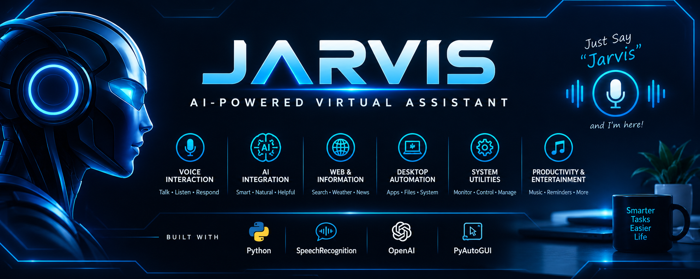

<div align="center">



</div>

# 🤖 Jarvis - AI-Powered Virtual Assistant

A Python-based virtual assistant that combines voice interaction, AI-powered responses, and desktop automation to make everyday computer tasks easier.

Jarvis listens for its activation name, processes voice commands, and responds through speech. It can help with everyday tasks such as opening applications, searching the web, managing reminders, checking system information, and controlling various desktop functions.

## ✨ Features

### 🎙️ Voice Interaction
- Voice-based command recognition.
- Voice responses using text-to-speech.
- Activate the assistant by saying "Jarvis".
- Ambient noise calibration for microphone input.

### 🧠 AI Integration
- AI-powered responses for commands that are not handled by predefined actions.
- Natural-language interaction through the configured AI service.

### 🌐 Web & Information
- Open popular websites.
- Search Google and Google Maps.
- Get weather information.
- Retrieve news headlines.
- Check the current date and time.
- Check internet connectivity.

### 💻 Desktop Automation
- Open applications such as Notepad, Calculator, File Explorer, VS Code, and Microsoft Edge.
- Open common folders, including Desktop, Documents, Downloads, Pictures, and Music.
- Take screenshots.
- Search for files and create text files.
- Read and copy clipboard text.
- Open Windows settings.

### ⚙️ System Utilities
- Check battery status and charging information.
- Monitor CPU and RAM usage.
- View system information.
- Increase, decrease, mute, and unmute system volume.
- Check and adjust screen brightness.
- Check Wi-Fi connectivity.
- Set alarms and manage reminders.
- Lock, restart, shut down, or put the computer to sleep, with confirmation for power actions.

### 🎵 Productivity & Entertainment
- Play songs from the configured music library.
- Perform basic calculations.
- Set timed reminders.
- Manage saved reminders.

## 🛠️ Technologies Used

- **Python** — application logic and automation.
- **SpeechRecognition** — speech input and recognition.
- **PyAudio** — microphone audio input.
- **pyttsx3** — text-to-speech responses.
- **OpenAI API** — AI-powered responses.
- **PyAutoGUI** — desktop automation.
- **psutil** — system and resource monitoring.
- **Requests** — HTTP requests for supported online services.
- **Git & GitHub** — version control and project hosting.

## 📁 Project Structure

```text
jarvis-virtual-assistant/
│
├── mainCGPT.py          # Main program and voice-command processing
├── ai.py                # AI-powered response handling
├── speech.py            # Text-to-speech functionality
├── musicLibrary.py      # Music playback
│
├── alarm.py             # Alarm functionality
├── reminder.py          # Reminder management
├── calculator.py        # Basic calculations
├── weather.py           # Weather information
├── news.py              # News headlines
├── websites.py          # Website opening and web searches
├── maps.py              # Google Maps searches
│
├── apps.py              # Application launching
├── folders.py           # Folder navigation
├── file_search.py       # File searching
├── text_file.py         # Text-file creation
├── clipboard.py         # Clipboard utilities
├── screenshot.py        # Screenshot capture
│
├── battery.py           # Battery information
├── system_info.py       # System, CPU, and RAM information
├── system_control.py    # Computer locking
├── power.py             # Power-management operations
├── volume.py             # Audio-volume controls
├── brightness.py        # Screen-brightness controls
├── wifi.py              # Wi-Fi status
├── internet.py          # Internet connectivity
├── settings.py          # Windows settings shortcuts
├── recycle_bin.py       # Recycle Bin management
│
├── requirements.txt     # Python dependencies
├── .gitignore           # Git exclusion rules
└── README.md            # Project documentation
```

## 🚀 Getting Started

### Prerequisites

Before running Jarvis, make sure you have:

- Windows operating system.
- Python installed.
- A working microphone.
- An internet connection for online services.
- The API credentials required by the services you configure.

Some system-control features are Windows-specific.

### 1. Clone the Repository

Open a terminal and run:

```bash
git clone https://github.com/nikitasolanki2309/jarvis-virtual-assistant.git
```

### 2. Navigate to the Project Directory

```bash
cd jarvis-virtual-assistant
```

### 3. Create a Virtual Environment

```bash
python -m venv .venv
```

Activate it in Windows PowerShell:

```powershell
.\.venv\Scripts\Activate.ps1
```

If you use Command Prompt instead:

```cmd
.venv\Scripts\activate.bat
```

### 4. Install Dependencies

```bash
python -m pip install -r requirements.txt
```

**Note:** Audio-related packages may require additional setup depending on your Python version and Windows environment.

### 5. Configure API Credentials

Some features require API credentials.

Configure the necessary credentials for the services you use before running the assistant. Keep your API keys private and never commit them to GitHub.

### 6. Run Jarvis

```bash
python mainCGPT.py
```

Wait for the initialization and microphone calibration to finish.

Say **"Jarvis"** to activate the assistant, then speak a supported command.

## 💬 Example Voice Commands

Try commands such as:

| Category | Example |
|---|---|
| Websites | "Open YouTube" |
| Web Search | "Search Python tutorials" |
| Maps | "Search maps coffee shops" |
| Weather | "Weather" |
| Date & Time | "What is the time?" |
| Calculator | "Calculate 25 plus 15" |
| Applications | "Open Notepad" |
| Music | "Play [song name]" |
| Reminders | "Remind me to study Python" |
| System Information | "CPU usage" |
| Battery | "Battery" |
| Volume | "Volume up" |
| Brightness | "Increase brightness" |
| Screenshots | "Take screenshot" |
| File Management | "Find file [file name]" |

The available commands depend on the implemented command handlers and your system configuration.

## 🔐 Security & Privacy

- Never upload API keys, passwords, or other secrets to GitHub.
- Keep sensitive configuration files out of version control.
- Voice recognition and AI features may send audio-derived text or prompts to external services.
- Review the privacy policies of any external services you configure.
- Review commands carefully before using features that modify system settings or perform power operations.

## 🎯 Project Goals

This project is a practical exploration of Python development, AI integration, voice interfaces, and Windows desktop automation.

It brings together multiple Python modules to create a single assistant capable of handling a variety of everyday tasks.

## 🔮 Future Improvements

- Add a graphical user interface.
- Improve natural-language command understanding.
- Add configurable user preferences.
- Improve error handling and command feedback.
- Expand the range of supported commands.
- Add automated tests for individual modules.

## 👩‍💻 Author

**Nikita Solanki**

- GitHub: [nikitasolanki2309](https://github.com/nikitasolanki2309)
- LinkedIn: [Nikita Solanki](https://www.linkedin.com/in/nikita-solanki-9aab38397/)

---

⭐ If you find this project interesting, consider giving the repository a star!